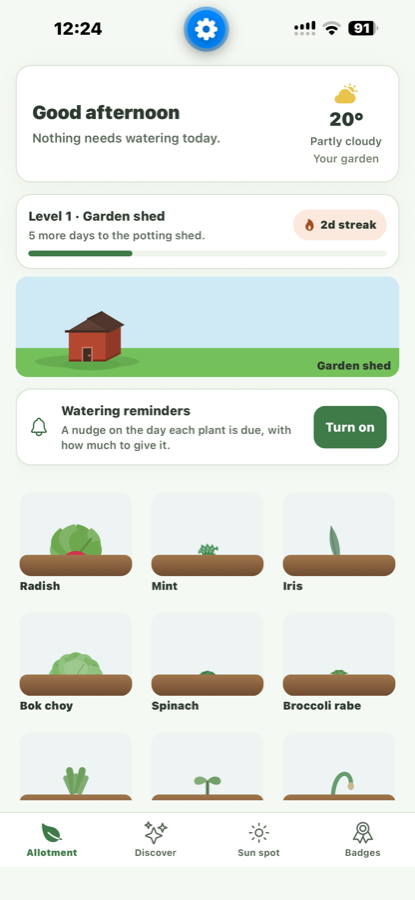
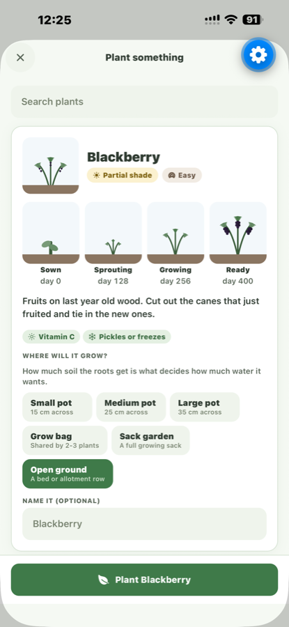
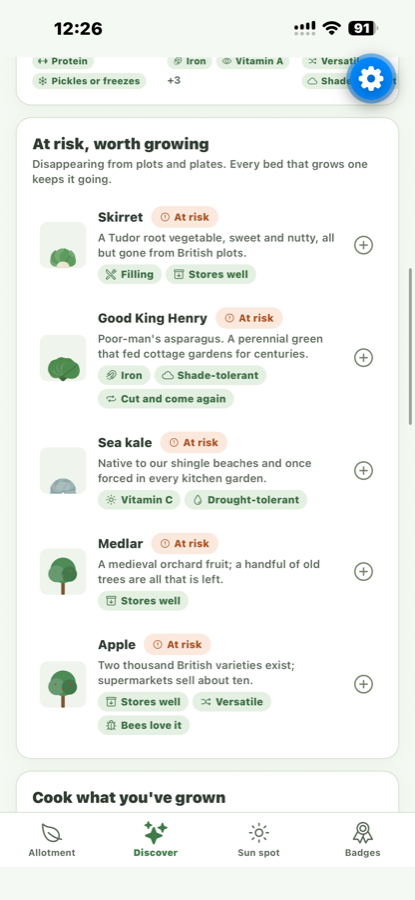
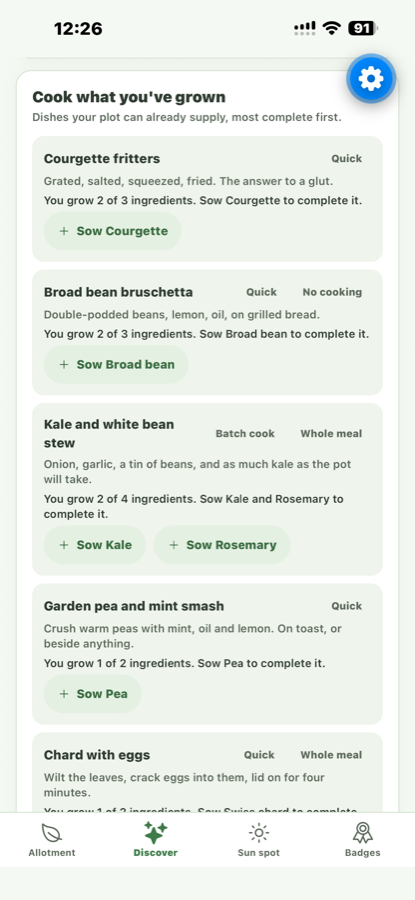
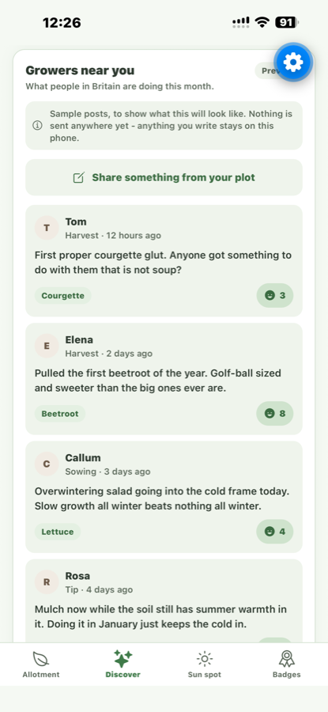

# Rooted

**A gardening companion app that helps people grow their own food.** Every plant you own gets an
on-screen twin that grows as the real one does, with watering driven by live weather and a
sun-path survey that tells you how many hours of direct sun a spot in your garden gets.

🏆 **Joint first place, Aegis Innovation Competition 2026** (University of Bristol), from 600+ applicants.
I came up with the idea, led a four-person team and was the sole engineer on the app. It was
built in 12 weeks with AI-assisted development (Claude Code) and demonstrated live on a phone at
the showcase.

<p>
  
  
  
  
  
</p>

## The engineering worth looking at

| What | How it works | Where |
| --- | --- | --- |
| **Sun-path survey** | Implements the US Naval Observatory low-precision solar-position algorithm (~0.1° accuracy). From the phone's coordinates and the date it derives the sun's azimuth and elevation, samples the whole day, and counts the samples that clear the skyline and fall within 90° of the direction the phone faces. That count is the spot's direct-sun hours. | [`src/services/sunPath.ts`](src/services/sunPath.ts) |
| **Measuring plants from a photo** | Stand an object of known size in the soil; the ratio between it and the plant is fixed whatever the camera distance, so `plant_cm = reference_cm × (plant_px ÷ reference_px)`. The motion sensor drives an on-screen spirit level, because a tilted frame skews the ratio. | [`src/screens/MeasureModal.tsx`](src/screens/MeasureModal.tsx) |
| **Live weather** | Open-Meteo forecast keyed off the device's location, with WMO weather codes mapped to the app's own conditions and a frost override below 0.5 °C. A deterministic seasonal model is kept as the offline and permission-denied fallback. | [`src/services/weather.ts`](src/services/weather.ts) |
| **Plant sprites** | Drawn as SVG, not photographed. Every dimension is driven by the plant's real progress towards harvest, and each sways on its own seeded clock, hinged at the soil. | [`src/components/PlantSprite.tsx`](src/components/PlantSprite.tsx) |
| **Crop library** | 165 crops with region-aware recommendations. Only two things change between countries, the weather (automatic from location) and the crop list, so the app is built for Britain and Kenya from one codebase. | [`src/models/species.ts`](src/models/species.ts) |

## Two builds

- **Expo / React Native** (this folder): runs on any phone through Expo Go. This is the build that was demonstrated at the competition. ~12,000 lines of TypeScript.
- **Native SwiftUI** ([`ios-swiftui/`](ios-swiftui/)): the original iPhone prototype, iOS 17+. ~3,000 lines of Swift.

## Running it

```bash
npm install
npx expo start
```

Scan the QR code with Expo Go. For LAN, port, sign-in and screenshot-harness details, see
[docs/EXPO-DEVELOPMENT.md](docs/EXPO-DEVELOPMENT.md).

## Stack

TypeScript · React Native · Expo SDK 57 · react-native-svg · expo-location · expo-sensors ·
expo-notifications · AsyncStorage · Open-Meteo · SwiftUI (native build)

---

Built by [Freddy Salem](https://github.com/freddysalem), Design Engineering, University of Bristol.
